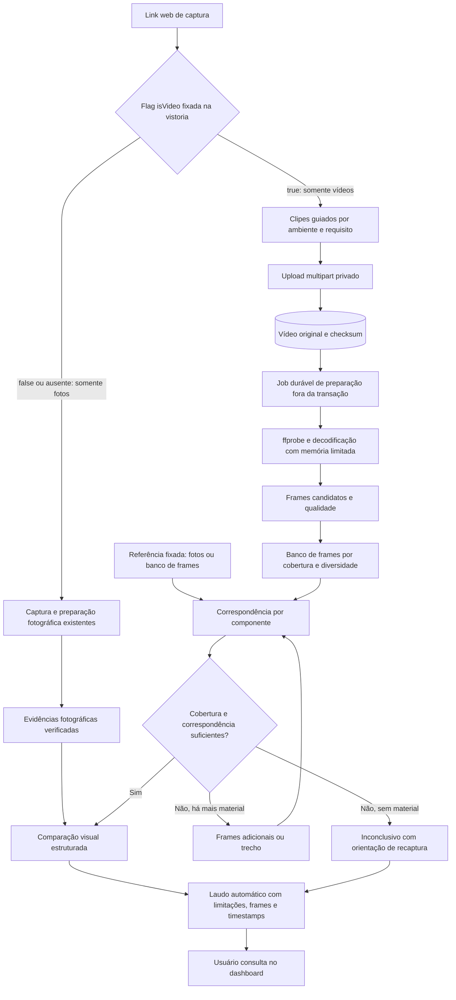

# Estudo: vistoria e comparação de ambientes por vídeo no Inspection

| Item | Valor |
| --- | --- |
| Situação | Estudo e proposta de evolução. Nenhuma capacidade de vídeo foi implementada, medida ou validada em produção. |
| Data da pesquisa | 13 de outubro de 2026. Preços e versões são um retrato dessa data. |
| Código consultado | Checkout baseado em `b4e94122`, incluindo alterações locais ainda não commitadas. |
| Moeda | Valores em USD, salvo indicação. Conversões usam PTAX de venda de 13/10/2026: **R$ 5,0096/USD**. |
| Unidades | MB/GB decimais; limites do código em MiB binários; GCS cobra por GiB. |

## Sumário executivo

**Recomendação.** Oferecer vistoria por vídeo como uma nova modalidade, ao lado da vistoria por fotos, usando **clipes curtos e guiados por ambiente** gravados no navegador. O servidor preserva o original, extrai frames rastreáveis e os entrega ao fluxo de análise por imagens que já existe. A primeira entrega útil é **foto de referência × vídeo atual**, que aproveita o acervo fotográfico; **vídeo × vídeo** vem depois, com referência organizada por ambiente e componente.

**Decisões de produto já tomadas** (§1): captura somente pelo link web, sem aplicativo nativo; a vistoria por fotos continua completa; uma flag booleana no modelo de vistoria (`isVideo`, nome proposto) define a modalidade exclusiva de toda a vistoria; o laudo é gerado automaticamente e consultado no dashboard, sem fila de revisão humana por vistoria.

**O que o código atual exige** (§2): o pipeline de mídia é exclusivamente de imagens e processa tudo em memória dentro da transação do consumer. Vídeo precisa de validação por streaming, job durável fora da transação, identidade própria para cada frame e um campo novo no schema versionado de templates.

**Custos** (§9): a IA não é o custo dominante. Com o modelo configurado hoje (Gemini 3.6 Flash), comparar dois vídeos de 10 minutos por frames selecionados custa cerca de **US$ 0,05 por par em 2026 e US$ 0,09 a partir de 2027**, quando a tarifa dobra. Guardar original e frames por 12 meses custa cerca de **US$ 0,07 por captura de 10 minutos** em R2 ou **US$ 0,12** em OCI. Upload pelo celular, recaptura, suporte e processamento tendem a pesar mais que tokens e storage.

**Maior risco:** correspondência e cobertura. Um dano que não chega a um frame selecionado não pode ser encontrado por nenhum modelo (§6.3). Como o laudo é publicado sem aprovação humana, um “sem alteração” errado chega direto ao cliente; por isso a liberação depende de recall medido por categoria e de abstenção confiável quando a evidência é insuficiente (§10).

**Próximos passos:** (1) testar gravação e upload pelo link em uma matriz de aparelhos; (2) montar um corpus anotado e comparar os pipelines com o avaliador já existente em `scripts/analysis-eval.mjs`; (3) só então especificar contratos e migrations.

## 1. Premissas e escopo

Premissas obrigatórias:

1. **A vistoria acontece pelo link web** (`/capture/[linkToken]`), no navegador do celular. Instalar a PWA é opcional. Um aplicativo iOS/Android não é pré-requisito nem faz parte do escopo inicial.
2. **A vistoria exclusivamente por fotos continua sendo uma funcionalidade completa.** Vídeo é uma modalidade nova, habilitada gradualmente; nada no fluxo fotográfico pode passar a depender dela.
3. **Cada modelo de vistoria define uma única modalidade** por uma flag booleana (`isVideo`, nome proposto). `true`: somente vídeos. `false` ou ausente: somente fotos. Todos os requisitos seguem essa modalidade. O participante não escolhe entre foto e vídeo, e não existe modo misto nem escolha por requisito. Modelos e convites existentes mantêm o comportamento fotográfico.
4. **O laudo é automático.** Análise e geração do laudo não passam por fila de revisão ou aprovação humana; o usuário consulta resultado e evidências no dashboard. Avaliação humana neste estudo serve apenas para preparar e validar o produto antes da liberação (§10), não para operar cada vistoria.

Consequências diretas:

- Em vistorias por vídeo, detalhes e complementos são novos clipes. Frames, posters e recortes extraídos pelo servidor são **derivados técnicos**, não fotos enviadas pelo participante.
- A referência histórica pode ter modalidade diferente da vistoria atual (foto de origem × vídeo atual). Isso é uma comparação entre vistorias, não uma mistura de modalidades na captura.
- Se o vídeo não puder ser gravado ou enviado, o fluxo orienta nova tentativa, navegador compatível ou registro de impossibilidade, **sem** aceitar fotos como fallback.
- Sem revisão humana, evidência insuficiente precisa aparecer no laudo como resultado inconclusivo com orientação de recaptura, nunca como ausência de alteração.

Fora de escopo funcional: aplicativo nativo, biometria/faces/pose/Re-ID de pessoas, monitoramento contínuo por RTSP, câmeras 360° dedicadas e reconstrução 3D. Os três últimos podem voltar como evolução futura (§11).

## 2. O que existe no repositório

O produto já trata **conservação, inventário, limpeza, obstrução e qualidade da evidência**. O prompt de análise é de vistoria imobiliária e já considera diferenças de iluminação, enquadramento e visibilidade.

| Área | Evidência no código | Consequência para vídeo |
| --- | --- | --- |
| Captura | [`page.tsx`](../apps/capture/app/capture/%5BlinkToken%5D/page.tsx), [`prepare-image.ts`](../apps/capture/src/pwa/prepare-image.ts) | `input type="file"` com `capture="environment"`. Aceita JPEG, PNG, WebP, HEIC e HEIF até 20 MiB. Não há `getUserMedia` nem `MediaRecorder`. A redução para 2048 px no cliente depende de `NEXT_PUBLIC_CAPTURE_IMAGE_OPTIMIZATION`, que está `false` no compose OCI e na CI; em produção o original é enviado. |
| Política de origem | [`capture-policy.ts`](../apps/capture/src/pwa/capture-policy.ts), `capture/core/service.go` | Galeria só quando `allowGallery` e `captureSourcePolicy != CAMERA_ONLY`, regra repetida no servidor. Valores em uso: `CAMERA_DEFAULT`, `CAMERA_ONLY`, `CAMERA_OR_GALLERY`, `GALLERY_SOURCE`. |
| Upload | [`media/core`](../services/inspection/internal/features/media/core/core.go), [`uploads.ts`](../apps/capture/src/pwa/uploads.ts) | Multipart de 5 MiB, ETags por parte, idempotência por `clientMutationId` e URLs pré-assinadas de 15 minutos. `CreateMediaUploadInput` exige tamanho e SHA-256 **antes** do envio. A retomada é conduzida pelo cliente; `Reconcile` existe no servidor, mas não é exposto no GraphQL nem chamado pelo Capture. |
| Validação | [`objectstore.go`](../services/inspection/internal/platform/objectstore/objectstore.go) | Admite apenas MIME de imagem (com verificação de magic bytes). `Complete` lê o objeto inteiro em memória (até 20 MiB), aplica `image.DecodeConfig`/`image.Decode` e calcula SHA-256, dentro de uma transação com `FOR UPDATE`. Aumentar o limite não resolve vídeo. |
| Rascunhos locais | [`drafts.ts`](../apps/capture/src/pwa/drafts.ts) | IndexedDB guarda o Blob e o estado do upload. `saveDraft` relê o Blob inteiro como `ArrayBuffer` e é chamado após cada parte; `digest()` também lê o arquivo inteiro; `loadDraftsForResponsibility` carrega todos os Blobs. Inviável para vídeos. |
| Preparação no worker | [`process_verified`](../services/inspection/internal/features/media/process_verified/setup.go) | Gera `DISPLAY` e `ANALYSIS` (imagens de até 2048 px) e executa o screening, tudo na transação do consumer ([`dispatcher.go`](../services/inspection/internal/platform/messaging/dispatcher.go)). Vídeo de minutos não pode seguir esse caminho. |
| Derivados | [`models.go`](../services/inspection/internal/platform/database/models.go), [`planner.go`](../services/inspection/internal/platform/database/migrations/planner.go) | `media.derivatives` tem unicidade `(tenant_id, media_id, kind)` e trigger de imutabilidade. Não cabem vários frames `ANALYSIS` do mesmo vídeo. |
| Templates | [`templates/catalog/compiler.go`](../services/inspection/internal/features/templates/catalog/compiler.go) | `templates.template_versions` guarda o documento JSON. O compilador exige `schemaVersion == 1` e usa `DisallowUnknownFields`: um campo novo exige evolução do schema. Requisitos usam `minimumCount`/`maximumCount`; `evidenceKind` e `captureSourcePolicy` aceitam qualquer string e hoje são sempre `PHOTO` e políticas de câmera. |
| Referência | [`build_request`](../services/inspection/internal/features/analysis/build_request/setup.go), `origins/resolve_reference` | Em `FIXED_ORIGIN`, cada requisito `origin:<mediaId>` aponta para **uma foto de origem**. O builder aceita várias atuais, mas `resolve_reference` gera os requisitos com mínimo e máximo 1: na prática, um par foto × foto. Não há referência espacial por ambiente. |
| Contrato de análise | [`comparative/request.go`](../services/inspection/internal/features/analysis/comparative/request.go), [`request_comparisons`](../services/inspection/internal/features/analysis/request_comparisons/setup.go) | Evidências com papel `ORIGIN`/`CURRENT`, `pairId`, posição e digest; `Build` rejeita IDs duplicados; o `mediaId` é usado como `evidenceId`. Um job por resposta de requisito. |
| Gateway de IA | [`litellm.go`](../services/inspection/internal/platform/llm/litellm.go), [`config.yaml`](../deploy/litellm/config.yaml) | Envia imagens base64 com `detail: high` a `/v1/chat/completions`, com schema estrito e timeout de 30 s. Rejeita o que não for `data:image/`. Modelo configurado: **`gemini/gemini-3.6-flash`** (local e OCI). |
| Regras de análise | [`default_system_prompt.go`](../services/inspection/internal/features/analysis/prompt/default_system_prompt.go), `prompt/definition.go` | Proíbe confundir “não visível” com “ausente” e exige evidência visível para dano, ausência e substituição. O limiar de confiança vem de `MinimumConfidenceBPS = 8500`; o 0,85 do prompt é apenas fallback. |
| Screening | `media/core`, `platform/sensitivecontent` | Heurística embarcada de pele/rosto sobre o `DISPLAY`, com bloqueio e declaração de falso positivo auditada. |
| Consumo de IA | [`observed.go`](../services/inspection/internal/platform/llm/observed.go), [`llm-observability.md`](llm-observability.md) | `usage.llm_calls` registra tokens, custo informado pelo provider, quantidade de imagens, bytes e duração, sem estimar. **É a fonte para calibrar tokens reais por imagem.** |
| Avaliação | [`analysis-eval.mjs`](../scripts/analysis-eval.mjs) | Compara prompts, modelos e conjuntos de imagens em casos rotulados, com cenários obrigatórios (`thin_crack`, `small_stain`, `lighting_variation`...), precisão, recall, tokens, custo e latência p50/p95. Base natural do experimento do §10. |
| Retenção | [`purge_data`](../services/inspection/internal/features/retention/purge_data/setup.go), `retention.legal_holds` | Purge de derivados e legal hold por GraphQL. Precisa incorporar vídeos, frames, segmentos e vetores. |
| Infraestrutura | [`deploy/oci/compose.yaml`](../deploy/oci/compose.yaml), [`Caddyfile`](../deploy/oci/Caddyfile) | Object storage S3 compatível da OCI, com proxy Caddy para PUT/GET/HEAD/OPTIONS. VM `VM.Standard.A1.Flex` (ARM64). |

Outros pontos relevantes:

- **Modos de comparação.** O GraphQL expõe somente `CHECKLIST_ONLY` e `FIXED_ORIGIN`. Existem nomes internos adicionais (`PLANNED_STAGE`, `PREVIOUS_INSPECTION`, `BEFORE_AFTER` no compilador; `CURRENT_ONLY` e `COMPARE_ORIGIN_CURRENT` na análise) que não comprovam disponibilidade ponta a ponta.
- **Limites de fotos** aparecem em `capture/core` (`MaxActivePhotos = 200`), `templates/catalog`, `objectstore` e `media/core`: não basta alterar uma constante.
- **Sessão do Capture.** Cookie `inspection_external` HttpOnly, CSRF em memória e link em `sessionStorage` ([`capture-session.ts`](../apps/capture/src/auth/capture-session.ts)). Retomar um rascunho exige reautenticação.
- **Service worker.** [`sw.js`](../apps/capture/public/sw.js) só armazena manifesto, ícone e `/_next/static/`. Não há reabertura offline completa nem upload em segundo plano.
- **Autorização.** `AcceptProcessingInput.photoProcessing` e os textos de consentimento citam somente fotos.
- **Retry de metadados.** O cliente tenta `saveCaptureMetadata` até 30 vezes com intervalo de 1 s; para vídeo, isso confundiria preparação normal com falha.
- **Possível falha pré-existente em `FIXED_ORIGIN`.** A promoção de vistoria para origem (`origins/promote_inspection`) copia apenas o derivado `DISPLAY`, enquanto `build_request` busca o derivado `ANALYSIS` da foto de origem. Constatado por leitura de código, sem execução. Como foto × vídeo depende dessas origens, vale confirmar antes do piloto.
- **Documentação desatualizada.** [`limitations.md`](limitations.md) afirma que não há manifesto de deploy de produção e cita MinIO; para este estudo prevalecem os arquivos de `deploy/oci`.

## 3. O que significa comparar ambientes

Existem três perguntas distintas:

| Pergunta | Exemplo | Técnica principal |
| --- | --- | --- |
| Correspondência | “Este frame mostra a mesma bancada da referência?” | Identidade do ambiente, recuperação visual e correspondência geométrica. |
| Mudança observável | “A bancada tem uma lasca que não aparece na referência?” | Comparação localizada, múltiplas vistas e análise de condição. |
| Cobertura | “Há evidência suficiente da bancada para concluir algo?” | Checklist de componentes, qualidade e regiões visíveis. |

Uma similaridade de embeddings de 0,97 não significa “97% de conservação” nem “97% de chance de ser o mesmo imóvel”: é proximidade no espaço do modelo. Uma cozinha diferente pode ser semanticamente parecida, e uma cozinha idêntica com uma fissura nova continua muito parecida.

No Inspection, a identidade do ativo vem do fluxo autorizado e a identidade do ambiente deve vir da captura guiada. A IA confirma correspondências e condições; não precisa redescobrir no acervo qual imóvel está sendo vistoriado.

Resultados de produto sugeridos para o laudo:

- **Alteração observada:** componente correspondente e evidência localizada nas duas datas.
- **Sem alteração relevante observada:** somente para o escopo efetivamente visível e comparável.
- **Não comparável:** enquadramento, obstrução ou qualidade impedem concluir.
- **Recaptura necessária:** orientação específica, como “aproxime a câmera do rodapé à direita da porta”.

O resultado deve distinguir mudança física, de inventário, sujeira, obstrução e mudança de captura. Detectar uma alteração não determina sua causa nem a responsabilidade.

## 4. Referências de mercado e pesquisa

As fontes comerciais documentam funcionalidades e casos publicados pelos próprios fornecedores; não revelam algoritmos nem comprovam acurácia em danos pequenos.

| Solução | Capacidade documentada | Lição para o Inspection |
| --- | --- | --- |
| **OpenSpace Capture** | Capturas 360° mapeadas na planta e comparação de duas datas em *Split View*. Caso Namibia Construction: capturas diárias e redução pela metade das viagens ao local. [Produto](https://www.openspace.ai/products/capture/), [caso](https://www.openspace.ai/resources/case-studies/namibia-construction/). | Priorizar correspondência de local e navegação entre datas. O valor relatado é de documentação e consulta remota, não de detecção automática de danos. |
| **PlanRadar SiteView** | Converte uma gravação de câmera 360° compatível (Insta360 X4/X5) em imagens posicionadas na planta 2D por SLAM visual. Upload pela web existe, mas não é recomendado. [Documentação](https://help.planradar.com/pt-br/siteview/). | Copiar o conceito de vistas localizadas, sem supor que vídeo de celular pelo navegador forneça essa localização. |
| **Dalux SiteWalk** | Câmera 360° com aplicativo, comparação entre datas e com BIM, exportação de imagens. [Produto](https://www.dalux.com/solutions/reality-capture/). | Inspirar a navegação por local e data; o Inspection pode começar com cômodo e ponto de vista declarados. |
| **Cupix SiteInsights** | Mudanças entre capturas 360° e progresso; a FAQ exige BIM para medir progresso automaticamente. [Produto](https://www.cupix.com/product/smart-progress-tracking). | Referência para obras; não comprova detecção de desgaste residencial sem BIM. |
| **Buildots** | Compara capturas de obra com BIM e cronograma. [Produto](https://buildots.com/product/). | Referência estruturada melhora a comparação. |
| **Matterport** | Comparação lado a lado de dois modelos do mesmo espaço, **em beta**, com alinhamento manual e navegação que falha quando os pontos de scan diferem. Caso Scan Space (ago/2026): relatórios de dilapidação de 2–3 h para cerca de 20 min. [Recurso](https://support.matterport.com/s/article/Side-by-Side?language=en_US), [caso](https://matterport.com/industries/case-studies/scan-space-cut-dilapidation-reporting-time-from-hours-to-minutes-with-matterport-digital-twins). | Contexto espacial e marcações tornam a leitura mais rápida; hardware e hospedagem 3D precisam justificar o custo. |
| **zInspector** | Inspeções por área e relatório que reúne entrada e saída, com acesso aos vídeos e fotos de cada vistoria. [Comparação](https://support.zinspector.com/compare-move-inmove-out-inspections-video/). | Fluxo mais próximo do Inspection: checklist, referência anterior e evidências. A comparação é de relatórios; não há detector automático vídeo × vídeo documentado. |
| **TwelveLabs** | APIs de indexação, busca (Marengo) e análise (Pegasus) de vídeo. [Índices](https://docs.twelvelabs.io/docs/concepts/indexes), [preços](https://www.twelvelabs.io/pricing). | Alternativa gerenciada para análise temporal; exige validação específica para condição. |
| **NVIDIA VSS** | Um detector gera candidatos e um VLM verifica trechos curtos para reduzir falsos positivos. [Workflow](https://docs.nvidia.com/vss/latest/agent-workflow-alert-verification.html). | Ideia útil de verificação escalonada. O verificador não recupera candidatos que o filtro deixou passar. |
| **Trembit** | Cobertura de cômodos por webcam no navegador, com CLIP ViT-B/32, suavização temporal, Python/Gradio e GPU. [Caso](https://trembit.com/case-studies/ai-room-coverage-inspection/). | Acesso por URL com inferência no servidor. “Cômodo visitado” não equivale a “superfícies documentadas”. |

**Padrão inferido:** registrar capturas no mesmo contexto espacial e temporal, selecionar evidências e apresentar diferenças a uma pessoa que interpreta o resultado. Nenhuma fonte sustenta que um vídeo arbitrário permita detectar automaticamente todas as avarias com precisão conhecida, e nenhuma descreve política de armazenamento, retenção ou custo por captura. Como o Inspection publica o laudo sem revisão humana, precisa ser mais conservador que essas ferramentas ao afirmar ausência de alteração.

Câmeras 360° ampliam a cobertura, mas distribuem a resolução pela esfera; defeitos pequenos continuam exigindo aproximação. Um percurso com celular orientado por requisito é mais compatível com a PWA atual e não exige hardware.

**Pesquisa.** ChangeSim ([arXiv 2103.05368](https://arxiv.org/abs/2103.05368)) usa ambientes industriais simulados e mostra que o pareamento de vistas é um gargalo antes da detecção de mudança. OmniDiff ([ICCV 2025](https://openaccess.thecvf.com/content/ICCV2025/papers/Liu_OmniDiff_A_Comprehensive_Benchmark_for_Fine-grained_Image_Difference_Captioning_ICCV_2025_paper.pdf)) é um benchmark de descrição de diferenças finas, útil para desenhar a avaliação. Nenhum substitui um corpus de imóveis e aparelhos reais.

## 5. Tecnologias candidatas

| Tecnologia | O que oferece | Uso possível e limite |
| --- | --- | --- |
| **FFmpeg/ffprobe** | Sondagem, decodificação, amostragem, detecção de cena, remoção de frames semelhantes. [Filtros](https://ffmpeg.org/ffmpeg-filters.html). | Base obrigatória da preparação no servidor. Detecção de cena não segmenta um percurso contínuo por ambiente. |
| **Gemini 3.6 Flash** (configurado), **3.8 Flash** e **3.5 Flash-Lite** | Entendimento de imagem e vídeo; *agentic video understanding* explora a linha do tempo ajustando FPS e resolução. [Vídeo](https://ai.google.dev/gemini-api/docs/video-understanding), [modelos](https://ai.google.dev/gemini-api/docs/models/gemini-3.5-flash-lite). | Comparar frames selecionados com vídeo direto. O 3.6 Flash é a geração anterior e custa o mesmo que o 3.8 Flash. Economia de tokens em vídeos longos não garante busca exaustiva de danos. |
| **EmbeddingGemma 2** (06/10/2026) | Embeddings multimodais (texto, imagem, áudio, vídeo), 740M parâmetros, 440M sem o encoder de áudio, Apache 2.0, até 58 frames no contexto de 8K, execução local. Dimensões Matryoshka 768/512/256/128. [Anúncio](https://blog.google/innovation-and-ai/technology/developers-tools/embeddinggemma-2/), [model card](https://ai.google.dev/gemma/docs/embeddinggemma/model_card_2). | Recuperar vistas correspondentes. Comparar 768 e 256 dimensões, renormalizando após truncar. **Não usar 128**: o model card a indica para texto e registra perda substancial em multimodal. Medir tempo e memória na VM ARM64. |
| **Gemini Embedding 2** (GA em abr/2026) | Embeddings gerenciados de texto, imagem, vídeo, áudio e PDF. [Model card](https://ai.google.dev/gemini-api/docs/models/gemini-embedding-2). | Alternativa gerenciada; custo de vídeo é alto em relação ao de imagem (§9.6). |
| **SigLIP 2** (fev/2025) | Encoders imagem/texto em vários tamanhos. [Artigo](https://arxiv.org/abs/2502.14786). | Baseline de recuperação visual contra EmbeddingGemma 2. |
| **DINOv3** (ago/2025) | Features visuais densas. [Meta](https://ai.meta.com/blog/dinov3-self-supervised-vision-model/). | Correspondência e comparação de regiões; exige transformar features em decisões do domínio. |
| **ORB/AKAZE/SIFT + RANSAC**, **LightGlue** (2023), **LoMa** (abr/2026) | Correspondência local entre imagens; LoMa revisita matching em escala e supera ALIKED+LightGlue no benchmark HardMatch. [OpenCV](https://docs.opencv.org/4.12.0/d1/de0/tutorial_py_feature_homography.html), [LightGlue](https://arxiv.org/abs/2306.13643), [LoMa](https://arxiv.org/abs/2604.04931). | Confirmar sobreposição de vistas antes do VLM. Clássicos como baseline barato; LightGlue como candidato; LoMa como pesquisa. |
| **SAM 3.1** (mar/2026) | Segmentação e tracking com multiplexação de até 16 objetos por passagem. [Meta](https://ai.meta.com/blog/segment-anything-model-3/). | Isolar bancada, porta ou armário. Ganhos publicados medidos em GPU H100. |
| **VGGT** (CVPR 2025, best paper) | Câmeras, profundidade e geometria multivista. [Projeto](https://vgg-t.github.io/). | Alinhamento espacial futuro; reconstrução monocular não fornece escala métrica para medir fissuras. |
| **O-SCD** (CVPR 2026) | Detecção de mudança online com fusão multivista e 3D Gaussian Splatting, sem pose nem rótulos. [Artigo](https://arxiv.org/abs/2511.12370), [código](https://github.com/Chumsy0725/O-SCD). | Pesquisa diretamente relacionada; exige CUDA e adaptação ao domínio. Não é componente de baixo custo para o piloto. |
| **Qwen3.6-27B** (abr/2026) | VLM aberto com entrada de imagem e vídeo, Apache 2.0. [Model card](https://huggingface.co/Qwen/Qwen3.6-27B). | Candidato a inferência própria se volume, hardware e avaliação justificarem. |
| **V-JEPA 2** (jun/2025) | Representações de vídeo para compreensão física e robótica. [Meta](https://ai.meta.com/blog/v-jepa-2-world-model-benchmarks/). | Acompanhar; pouco aplicável à conservação estática. |

**Pilha do primeiro experimento:** FFmpeg + seleção por qualidade e cobertura + o VLM já integrado, com vídeo direto como baseline de comparação. Embeddings e correspondência local entram como variantes medidas. SAM, 3D e detectores especializados só quando os erros observados justificarem.

**Hipóteses comuns que este estudo não adota:**

| Hipótese | Posição |
| --- | --- |
| SSIM/embeddings descartam 95–98% das cenas com segurança | Sem evidência. Alta similaridade pode esconder dano pequeno; avaliar amostras descartadas. |
| Um frame representativo por cômodo basta | Serve como capa, não prova cobertura de paredes, piso, teto e inventário. |
| Classificar “cozinha/quarto” identifica o ambiente | Não distingue “quarto 1” de “quarto 2”; a identidade vem do roteiro e de correspondências verificadas. |
| Limiares universais (SSIM 0,94, cosseno 0,93) indicam conservação | Nenhum limiar global representa condição; calibrar por categoria. |
| CPU “praticamente zero” e upload “gratuito” | Contabilizar CPU, I/O, operações, retries, dados móveis e tempo do usuário. |
| Originais podem alimentar treinamento futuro | Exige decisão própria sobre autorização, dados e retenção. |
| Kafka, ClickHouse ou banco vetorial dedicado desde o início | Sem necessidade demonstrada; RabbitMQ e PostgreSQL atendem ao desenho (§6.4). |

## 6. Arquitetura proposta



**Divisão de trabalho:** o navegador cuida de captura, prévia, alertas simples, armazenamento local e transporte; o servidor cuida de validação, FFmpeg, correspondência, análise e geração do laudo. Abrir um convite não deve exigir WebGPU, download de modelo ou FFmpeg em WebAssembly.

### 6.1 Captura pelo link web

O participante abre o convite, autentica-se pelo fluxo existente e recebe os requisitos na modalidade do modelo. Para vídeo, vê o roteiro do ambiente e as regiões esperadas (com a foto de referência como orientação, quando houver), grava um clipe, confere a reprodução e confirma o envio. A interface distingue **salvo neste dispositivo**, **enviado** e **em preparação**.

| Alternativa | Benefício | Decisão |
| --- | --- | --- |
| `getUserMedia` + `MediaRecorder` na página | Roteiro, referência, cronômetro e prévia no mesmo contexto; câmera traseira e áudio desligado. | **Recomendada**, condicionada à matriz de dispositivos. Requer HTTPS e permissão; restrições de resolução e bitrate não são garantidas. |
| `input type="file" accept="video/*" capture="environment"` | Integração simples com a câmera do sistema. | Fallback avaliado por dispositivo. `capture` tem suporte variável e a página não controla duração nem limites. |
| Selecionar vídeo existente | Recupera gravação já salva. | Somente quando a política permitir galeria. Validar tamanho, codec e duração antes do upload quando possível e sempre no servidor. |
| Aplicativo nativo | Mais controle de câmera e tarefas em segundo plano. | Fora do escopo. Reavaliar apenas se a experiência web validada não atender. |

Fontes: [getUserMedia](https://developer.mozilla.org/en-US/docs/Web/API/MediaDevices/getUserMedia), [atributo capture](https://developer.mozilla.org/en-US/docs/Web/HTML/Reference/Attributes/capture), [MediaRecorder](https://developer.mozilla.org/en-US/docs/Web/API/MediaRecorder).

Parâmetros **propostos para o piloto**, a validar:

| Parâmetro | Proposta |
| --- | --- |
| Unidade de captura | Um clipe por ambiente, ou por requisito enquanto a referência for uma foto individual. Ambientes grandes podem ter vários clipes. |
| Duração | 30–60 s por clipe; máximo inicial de 90 s. Orçamento total ilustrativo de 10 minutos por vistoria (por exemplo, dez clipes de 1 minuto), não um arquivo único. |
| Resolução e FPS | 1080p a 24/30 FPS como alvo; registrar o que o aparelho realmente entrega. 30 FPS ajuda a escolher frames estáveis; não significa enviar 30 imagens por segundo à IA. |
| Bitrate | Alvo de 3–5 Mbps, medindo os arquivos; teto de admissão de 100 MiB por clipe. |
| Áudio | Desligado. Narração só em fluxo específico, com consentimento próprio. |
| Orientação | Movimento lento, pausa por superfície, aproximação de detalhes pequenos, reflexivos ou escuros, sem alternar lentes/zoom. |
| Cobertura | Checklist de superfícies e itens, não um contador de segundos. |

**Formatos.** Não presumir MP4/H.264. Consultar `MediaRecorder.isTypeSupported()`, registrar o MIME efetivamente produzido e manter uma lista explícita de combinações admitidas; resposta positiva não garante sucesso sob falta de recursos ([MDN](https://developer.mozilla.org/en-US/docs/Web/API/MediaRecorder/isTypeSupported_static)). Gravar, reproduzir e decodificar no servidor são capacidades distintas. Importações podem trazer HEVC, MOV, HDR ou FPS variável: aceitar somente após suporte demonstrado. Renomear a extensão não converte o codec.

**Política de origem.** `CAMERA_ONLY` é regra de produto; o atributo HTML e metadados do cliente não provam captura ao vivo. Registrar o método de aquisição. Se a política proíbe galeria, uma falha do gravador não a habilita.

### 6.2 Interrupções, rascunhos e upload

| Situação | Comportamento proposto |
| --- | --- |
| Link aberto em navegador interno de mensageiro | Detectar falta de capacidade e orientar abertura em navegador compatível; a nova sessão exige autenticação. |
| Permissão negada ou câmera ocupada | Explicar como tentar de novo ou registrar impossibilidade. Solicitar apenas câmera. |
| Tela bloqueada, ligação ou troca de aplicativo | Detectar interrupção, conferir integridade e duração do clipe e pedir retomada ou nova captura. |
| Rede perdida após gravar | Manter o clipe finalizado localmente, informar pendência e retomar com a página ativa. |
| Pouco espaço ou falha de persistência | Não mostrar “salvo”; oferecer envio imediato, nova tentativa ou impossibilidade. |
| Sessão ou URL de upload expirada | Reautenticar e reconciliar partes com o servidor; bloquear se o convite foi revogado ou encerrado. |
| Navegador fechado | Retomar apenas o que foi persistido; o último clipe interrompido pode ser irrecuperável. |

Pontos técnicos:

- `MediaRecorder.start(timeslice)` não é relógio confiável: Safari pode suspender a captura e o Chrome Android com tela bloqueada atrasa eventos. O timer da UI é independente; o servidor verifica a duração real ([dataavailable](https://developer.mozilla.org/en-US/docs/Web/API/MediaRecorder/dataavailable_event)).
- Chunks do gravador não são clipes independentes nem partes de 5 MiB; só a concatenação de uma gravação concluída é garantidamente reproduzível ([W3C](https://www.w3.org/TR/mediastream-recording/)). Como o contrato exige tamanho e SHA-256 antes do envio, **finalizar cada clipe antes de enviá-lo**. Upload durante a gravação exigiria outro protocolo.
- Refatorar `drafts.ts` com compatibilidade de rascunhos antigos: bytes imutáveis separados de estado, atualização por parte sem reler o Blob, hashing incremental em blocos (mover `digest()` para um Web Worker não resolve a leitura integral) e carregamento sob demanda. IndexedDB pode continuar no piloto; OPFS só se necessário.
- Expor a reconciliação de partes do servidor (`Reconcile` já existe) para que retomadas não reenviem bytes confirmados.
- Persistência local é melhor esforço: quotas e remoção dependem do navegador e navegação privada pode descartar dados ([quotas](https://developer.mozilla.org/en-US/docs/Web/API/Storage_API/Storage_quotas_and_eviction_criteria)). Rascunho local não é backup.
- [Screen Wake Lock](https://developer.mozilla.org/en-US/docs/Web/API/Screen_Wake_Lock_API) ajuda durante captura e envio, mas pode ser liberado pelo sistema. [Background Sync](https://developer.mozilla.org/en-US/docs/Web/API/Background_Synchronization_API) tem suporte limitado e não sustenta upload longo após fechar a página.
- Limpar rascunhos somente após confirmação durável do servidor. A modalidade permanece fixa em todas as retomadas.

### 6.3 Preparação e seleção de frames

Processar cada original uma vez e persistir o resultado versionado:

1. Verificar tamanho, checksum, container, codec, duração, dimensões e decodificação completa, com leitura em streaming e memória limitada.
2. Aplicar rotação/orientação aos derivados, preservando o original.
3. Amostrar candidatos em baixa resolução, por exemplo 1–2 FPS.
4. Selecionar janelas estáveis e nítidas; quando necessário, voltar ao trecho em frequência maior.
5. Reduzir redundância mantendo cobertura de superfícies e pontos de atenção. Um frame com defeito raro importa mesmo parecido com os vizinhos.
6. Reextrair do original, em resolução de análise, os frames e recortes selecionados.

O resultado é um **banco de frames do vídeo**, representativo independentemente de qualquer comparação específica. Como orçamento inicial, avaliar **6–12 frames por minuto de ambiente**; requisitos com muitos componentes podem exigir mais.

Perceptual hash reduz duplicação dentro de uma captura. SSIM e diferença de pixels só fazem sentido em regiões bem alinhadas e como sinais auxiliares. **Similaridade global nunca autoriza pular a avaliação de um componente obrigatório.** A economia inicial vem de reduzir redundância dentro do vídeo e escolher pares relevantes. Como o laudo é automático, qualquer redução posterior da análise exige recall validado por categoria antes da liberação.

Não usar melhoria generativa, preenchimento ou super-resolução na evidência que sustenta a decisão.

### 6.4 Correspondência entre datas

Filtrar por tenant, ativo, referência fixada e ambiente/requisito. Para cada foto ou frame de referência, recuperar poucos candidatos atuais e verificar compatibilidade de vista e conteúdo. A bancada pode aparecer aos 8 s na origem e aos 41 s na vistoria atual: a correspondência é por vista, não por timestamp ou ordem de percurso. Uma superfície pode ter vários frames, e uma região sem par permanece explicitamente sem cobertura.

**Alinhamento.** Usar ORB/AKAZE ou SIFT com RANSAC como baseline barato, ao lado de LightGlue. Exigir sobreposição, distribuição de pontos e erro geométrico aceitáveis antes de comparar pixels. Homografia só vale para superfícies aproximadamente planas. Paredes lisas, espelhos, grande mudança de ponto de vista e parallax podem impedir o alinhamento; nesse caso, buscar outra vista ou declarar “não comparável”.

**Localização sem planta.** Hierarquia `assetId → environmentId → componentId/viewpointId`, com pontos de vista como “parede da janela” ou “vista da bancada”. Classificação de cômodo pode sugerir rótulos, mas deve admitir “desconhecido”, transição e ambientes integrados.

**Embeddings e busca vetorial.** Registrar modelo, versão, dimensão, precisão e preparação; não comparar vetores incompatíveis. Com 60 frames por lado há 3.600 pares candidatos antes de filtros: busca exata no worker, carregando só os vetores do escopo autorizado, deve bastar (hipótese a medir).

| Alternativa | Quando faz sentido | Custo e limite |
| --- | --- | --- |
| Sem embeddings | Clipes guiados por requisito e correspondência local | Menos componentes; ângulos muito diferentes podem exigir mais. |
| Embeddings + busca exata restrita | Dezenas ou centenas de frames por ambiente e referência conhecida | Custo de geração; sem serviço adicional. |
| [pgvector](https://github.com/pgvector/pgvector) | Consultar vetores persistidos junto dos filtros relacionais | Busca exata por padrão, HNSW/IVFFlat se necessário; consome CPU e memória do PostgreSQL. Não está instalado hoje. |
| Milvus | Busca vetorial vira workload relevante de concorrência, latência ou escala | Novo componente com sincronização, isolamento por tenant, backup e monitoramento. Standalone em Kubernetes exige 8 GB de RAM e recomenda 4+ núcleos e 16 GB ([requisitos](https://milvus.io/docs/prerequisite-helm.md)). |

**Começar sem Milvus.** O banco vetorial não melhora a qualidade do embedding, o alinhamento nem a detecção. Reavaliar quando medições mostrarem impacto no banco transacional ou latência insuficiente.

### 6.5 Análise e laudo

Enviar ao VLM o requisito, papéis temporais, pares explícitos, cobertura conhecida e imagens, agrupando componentes relacionados por chamada. Manter contexto amplo junto dos recortes para o modelo não perder a localização. Quando o movimento importa (porta abrindo, água escorrendo), um trecho curto pode ir a um adaptador de vídeo, sem generalizar para diagnóstico de funcionamento.

O contrato atual aceita `ORIGIN`, `CURRENT`, `pairId`, posição e imagens, e o prompt já tem boas regras de condição, inventário e visibilidade. Mas **um vídeo não entra no contrato como se fosse uma foto**:

- cada frame precisa de `evidenceId` próprio, digest, vínculo ao vídeo, timestamp e escopo — reaproveitar o `mediaId` do vídeo violaria a unicidade de `comparative.Build` ou esconderia qual frame sustentou o achado;
- itens de atenção da origem precisam chegar às evidências derivadas;
- o prompt fixado precisa de uma versão que contextualize frames extraídos e várias vistas do mesmo componente, evitando achados duplicados. O prompt atual sem alterações serve de baseline do piloto.

Cada achado do laudo aponta para o frame analisado, o vídeo de origem, o timestamp e a região, quando houver. No dashboard, o usuário vê o par de imagens e pode abrir os vídeos nos instantes correspondentes; “sincronização” significa vistas correspondentes, não reprodução simultânea. Máscaras e caixas são anotações do método, sujeitas a erro: guardá-las separadas do frame, com coordenadas, versão e origem. Se o VLM só descreveu “parede direita”, não fabricar uma máscara precisa.

### 6.6 Reuso, cache e preparação sob demanda

Um **executor de mídia** recebe jobs, lê o storage, prepara evidências e entrega pares ao fluxo de análise. Pode ser outro processo/container do mesmo serviço Go, com FFmpeg, isolando CPU, memória, disco temporário e timeout. Um microserviço com API e banco próprios não é necessário. Um adaptador Python só se justifica para modelos que exigem esse runtime.

| Etapa | Resultado persistido | Reutilizar quando |
| --- | --- | --- |
| Preparação de um vídeo | Banco de frames, qualidade, cobertura e manifesto com timestamps | Mesmo conteúdo e mesma versão de extração/seleção. |
| Embeddings (opcional) | Vetores com modelo, versão e normalização | Mesmos frames e configuração. |
| Pareamento e análise | Pares, evidências e resultado estruturado | Mesmos manifestos e versões de pareamento, prompt e modelo. |

**Chave de idempotência proposta:** `(tenantId, sourceDigest, extractionVersion, selectionConfigDigest)`, com versão do decoder no manifesto. Unicidade e lease impedem preparações concorrentes; `READY` só é publicado com objetos e manifesto íntegros. “Não gerar de novo” significa reutilizar a mesma versão, não proibir reprocessamento: falha parcial, frames removidos ou mudança de algoritmo geram nova versão, e as evidências históricas permanecem imutáveis.

**Origem sob demanda.** Validar integridade, formato, duração e limites no recebimento e adiar a extração completa da origem até a primeira comparação é razoável quando muitas origens nunca serão usadas. Custos: maior latência no primeiro laudo e lacunas de cobertura descobertas tarde. Se isso prejudicar a recaptura, preparar antecipadamente. O original precisa permanecer retido até essa primeira preparação (§8.4).

**Deduplicação.** Remover redundância dentro de cada vídeo, preservando nitidez, detalhes e cobertura. Não descartar um frame atual por se parecer com a origem: o par também prova que o componente foi observado nas duas datas. Não guardar apenas frames com dano; isso apaga a evidência de cobertura.

Reutilizar frames economiza preparação, mas reenviar as mesmas imagens ao VLM é cobrado de novo. Só contar desconto de cache quando o consumo comprovar.

### 6.7 Histórico de várias datas

Registrar observações por data, componente, visibilidade e evidência, com estados como presente, ausente com cobertura suficiente, alterado, reparo observado e não observado. Ausência repetida em enquadramentos obstruídos continua inconclusiva. Frames consecutivos são correlacionados: dez observações quase iguais não são dez confirmações.

Para um achado, guardar a primeira observação e o intervalo entre a última condição conhecida e a primeira mudança visível, sem afirmar a data exata do evento. A referência fixada continua sendo a base daquela análise; datas intermediárias contextualizam persistência ou reparo sem promover automaticamente a última vistoria a origem. Reprocessamento gera nova versão do laudo, mantendo a anterior auditável.

## 7. Evolução dos contratos do Inspection

### 7.1 Modalidade exclusiva por modelo

| Flag no modelo | Modalidade da vistoria | Completude |
| --- | --- | --- |
| Ausente ou `false` | Somente fotos | Mínimos, máximos, fontes, screening, substituição e envio incompleto atuais, sem alteração. |
| `true` | Somente vídeos | Clipes aceitos por requisito e cobertura suficiente; detalhes e complementos em vídeo. |

- **Onde mora a flag.** No documento de template versionado. Como o compilador usa `DisallowUnknownFields` e exige `schemaVersion == 1`, é preciso aceitar o campo novo de forma compatível (nova versão de schema ou campo opcional explícito) e manter a leitura de versões sem ele.
- **Fixação.** Ao criar a vistoria, fixar a modalidade da versão do modelo. Mudar a flag afeta somente novas vistorias; convites ativos, rascunhos, análises e complementos mantêm a modalidade original. O bootstrap do Capture informa a modalidade efetiva e seus limites.
- **`evidenceKind`.** Hoje aceita qualquer string e é sempre `PHOTO`. Deve ser derivado da modalidade e validado, não uma segunda fonte de escolha.
- **Aplicação na API.** Admissão, associação, substituição e submissão de mídia rejeitam o tipo incompatível, inclusive em chamadas diretas e retomadas, validando o conteúdo real no servidor e não a extensão ou o MIME declarado. Políticas de câmera/galeria continuam independentes, restritas ao tipo da vistoria.
- **Derivados.** Um clipe é uma mídia de captura; seus 60 frames não contam como 60 fotos em `minimumMedia`, quotas, faturamento ou `evidenceCount`.
- **Três decisões separadas:** arquivo íntegro recebido, evidência apta à análise e conclusão de conservação. Duração suficiente não prova cobertura; cobertura suficiente não prova ausência de danos. A especificação decide se a cobertura é checada antes da submissão (pedindo recaptura enquanto o participante ainda está no local) ou se resulta em laudo inconclusivo; em ambos os casos, preparação pendente não é falha de upload.

Na edição do modelo, apresentar a opção **“Vistoria por vídeo”**, desmarcada por padrão.

### 7.2 Combinações de referência e captura

| Referência × captura atual | Comportamento esperado |
| --- | --- |
| Foto × foto | Fluxo existente, sem depender do executor de vídeo nem de embeddings. |
| Foto × vídeo | Localizar no banco de frames as vistas da foto fixada; emitir lacuna quando não houver par. **Primeira entrega.** |
| Vídeo × foto | Usar os frames fixados na versão da origem; fotos suficientes para os componentes exigidos. O participante não filma por causa do formato da origem. |
| Vídeo × vídeo | Comparar conjuntos de vistas/componentes correspondentes; timestamps podem diferir. |
| Sem origem (`CHECKLIST_ONLY`) | Avaliar condição e cobertura atuais na modalidade fixada, sem afirmar que um dano é novo. |

### 7.3 Modelagem de dados

Não modelar frames como fotos enviadas: isso inflaria contagens, completude, quotas e laudos. O vídeo continua sendo a mídia de captura, com **evidências derivadas** de identidade própria.

| Entidade | Campos ou relações |
| --- | --- |
| Modelo de vistoria | `isVideo`, default `false`; ausente equivale a `false`. |
| Mídia | `mediaKind`, `contentType`, `durationMs`, dimensões, codec, bitrate observado, presença de áudio, checksum e estado de preparação. |
| Ambiente/escopo | Identidade estável de ambiente e componente no ativo, além de `requirementKey`; mapeamento das referências legadas. |
| Segmento | `mediaId`, `startMs`, `endMs`, ambiente/requisito e versão da segmentação. |
| Frame | ID próprio, `sourceMediaId`, tempo de apresentação, hash, qualidade, dimensões e objetos de display/análise. |
| Recorte | Frame pai, coordenadas, hash e versão da transformação. |
| Correspondência | Evidência de origem, atual, componente, método, escore e decisão de comparabilidade. |
| Snapshot de entrada | IDs e hashes dos frames, manifesto de extração, referência, prompt, modelo e parâmetros. |
| Cobertura | Itens observados, parciais e não observados, com a causa da insuficiência. |

Guardar o tempo de apresentação real: com FPS variável, `índice / FPS nominal` dá o instante errado. Uma tabela `media.frames` com identidade própria evita forçar a unicidade de `media.derivatives` ou codificar timestamps em `kind`.

### 7.4 Processamento, eventos e API

GraphQL continua canônico: acrescentar tipo, duração, estado de preparação e progresso, e expor frames e timestamps no laudo, regenerando os tipos Go/TypeScript.

```text
upload em andamento → arquivo recebido → integridade e formato
→ preparação e screening → evidências prontas → comparação
→ geração automática do laudo → laudo disponível no dashboard
```

Eventos carregam IDs e metadados, nunca bytes. Uma transação curta cria o job (outbox); o executor obtém lease, processa **fora** da transação e uma nova transação curta publica o resultado. Falhas após o upload de derivados exigem idempotência e limpeza de órfãos. O retry de metadados do cliente (30 × 1 s) deve dar lugar a acompanhamento durável da preparação.

### 7.5 Organização por slices

Exemplos de operações novas, seguindo Vertical Slice:

```text
features/media/prepare_video/
features/media/select_video_frames/
features/analysis/match_evidence/
```

Cada operação expõe `setup.go` e registra seu comando/evento no mediator. Slices existentes de admissão, conclusão, metadados, referência, análise e relatórios evoluem conforme sua responsabilidade. Adapters de processo e storage ficam em plataforma só quando houver reutilização concreta. Migrations preservam tabelas e colunas, aplicam RLS e roles e entram em `migrations/planner.go`.

### 7.6 Impactos por área

1. **Capture (`page.tsx`):** escolher a experiência pela modalidade do bootstrap; nunca enviar vídeo para `prepareCaptureImage`.
2. **Rascunhos (`drafts.ts`):** versionar registros, separar bytes de estado, ler rascunhos fotográficos antigos sem invalidá-los, manter isolamento por responsabilidade.
3. **Upload (`uploads.ts`, `media/core`, `objectstore`):** reaproveitar multipart e idempotência; limites próprios de duração, bytes e formatos para vídeo; validação de vídeo por streaming, fora do `io.ReadAll` e da transação com `FOR UPDATE`; manter o limite fotográfico.
4. **Templates, GraphQL, editor e `capture-policy.ts`:** `isVideo` com default `false`, propagado até bootstrap e completude.
5. **Worker (`process_verified`):** imagens seguem o caminho atual; vídeos vão ao executor. Screening precisa de política para vídeo: verificar só poster ou frames enviados ao VLM não cobre todos os instantes reproduzíveis.
6. **Origens e `build_request`:** preservar referência fixada; promover vídeos exige manifesto versionado de frames, sem transformar cada frame em requisito.
7. **Autorização:** evoluir `photoProcessing` com aceite versionado para as mídias permitidas e tratamento de áudio, se habilitado. Não reinterpretar aceites antigos.
8. **Dashboard, laudo/PDF e retenção:** distinguir mídia capturada de evidência derivada; exibir vídeo com poster e timestamps. Falha do player não impede ler achados e frames.

### 7.7 Migração do acervo

- **Etapa A — foto de referência × vídeo atual:** cada requisito `origin:<mediaId>` continua apontando para sua foto. Um vídeo que cubra vários requisitos precisa de vínculos explícitos de segmento/frame antes de completá-los.
- **Etapa B — referência por ambiente:** agrupar fotos e frames por identificadores estáveis de ambiente e componente, editáveis na criação da referência. A descrição livre da foto não é chave.
- **Etapa C — vídeo × vídeo:** a origem fixa inclui manifesto de frames/segmentos e hashes. Nova seleção com outro algoritmo é nova versão técnica; laudos históricos não mudam.

### 7.8 Laudo, dashboard e observabilidade

O PDF continua usando imagens, identificando o frame e o tempo no vídeo. Links apontam para uma rota autenticada que gera acesso temporário na hora; uma URL assinada embutida no PDF expiraria.

No dashboard, apresentar o laudo, os pares, as limitações e o acesso ao trecho. Evidência insuficiente aparece como resultado inconclusivo com orientação de recaptura; o laudo é publicado sem aguardar aprovação humana. Se houver canal de contestação, registrar as contestações como sinal para a avaliação contínua do produto, sem criar etapa de aprovação.

O ledger `usage.llm_calls` já registra tokens e custo reais. Acrescentar minutos recebidos, CPU-segundos, bytes de derivados, frames candidatos/selecionados, chamadas por etapa, fallbacks, bytes lidos, taxa de inconclusivos e de recaptura, separados por modalidade. Custos não informados pelo provider continuam desconhecidos, com estimativas exibidas à parte.

### 7.9 Rollout e reversão

- Marcar a flag primeiro em novas versões de modelos de piloto, com métricas separadas.
- Ter um controle operacional para **criação** de novas vistorias por vídeo independente do processamento e da leitura das existentes.
- Ao interromper o piloto, preservar modalidade, acesso, jobs e retomadas das vistorias já criadas.
- Reservar capacidade de worker para fotos e aplicar orçamento de bytes, minutos e concorrência ao vídeo. Indisponibilidade do executor de vídeo nunca bloqueia bootstrap, upload ou análise fotográfica.

## 8. Armazenamento e retenção

### 8.1 Conjunto recomendado

| Artefato | Onde | Por quê |
| --- | --- | --- |
| Original recebido | Bucket privado | Reprocessamento, auditoria e vínculo com o checksum. |
| Proxy de reprodução (opcional) | Mesmo bucket | Navegação leve quando o original não for compatível. |
| Poster/miniaturas | Bucket | Listagem rápida. |
| Banco de frames e recortes | Bucket | Evidência exata da análise e do laudo. |
| Metadados e linhagem | PostgreSQL | Tenant, ativo, ambiente, tempo, qualidade, hashes, versões e estado. |
| Embeddings | PostgreSQL ou armazenamento técnico | Recalculáveis a partir da mídia. |
| Candidatos intermediários | Disco temporário | Excluídos ao fim do job. |

Um checksum atesta a integridade do objeto, não a data, o local ou a autenticidade da cena.

### 8.2 Formato e reprodução

Para reprodução, avaliar MP4/H.264 com índice no início (`faststart`) e HTTP Range. MP4 é um container: a extensão não garante H.264, e arquivos de celular podem exigir remux ou transcodificação. Transcodificar só por compatibilidade ou economia medida, sem criar cópia normalizada de igual tamanho sem finalidade. HLS/DASH não são necessários para clipes curtos privados.

Avaliar no proxy Caddy do OCI o suporte a Range (`206`, `Content-Range`), a duração das URLs e o tráfego de upload/download: todo o tráfego de storage passa por ele, e migrar o bucket sem considerar o proxy não elimina esse consumo.

### 8.3 Retenção

Separar políticas de originais, banco de frames e derivados regeneráveis. **Uma referência ativa não pode ser excluída porque seu upload é antigo**, e regras automáticas do bucket não podem apagar evidência necessária ou sob legal hold: o scheduler de retenção coordena dependências, objetos, vetores e registros.

O OCI Archive custa US$ 0,0026/GB-mês, exige restauração antes do download e tem retenção mínima de 90 dias ([documentação](https://docs.oracle.com/en-us/iaas/Content/Archive/Concepts/archivestorageoverview.htm)). Serve para originais raramente acessados, com estado “restauração pendente” no produto; restore e operações entram na conta.

Isolamento por tenant vale também para frames, recortes, embeddings e caches. Áudio e informações pessoais incidentais exigem política consistente com a captura.

### 8.4 Guardar só frames após a preparação

É possível tratar o vídeo como entrada temporária e conservar apenas o banco de frames. Depois do descarte, não há reprodução integral nem como recuperar uma vista que a seleção deixou de fora; o digest registra a identidade do original, mas não o reconstrói.

**No piloto, preservar os originais.** É preciso medir falsos negativos da seleção, investigar pares errados e avaliar cobertura. Proposta: manter o original durante preparação e geração do laudo, com janela operacional configurável (30 dias após a conclusão é exemplo de dimensionamento, não política aprovada). Origens ativas ficam retidas por mais tempo, pois serão reutilizadas. Com preparação sob demanda, a origem precisa sobreviver até sua primeira preparação; uma expiração cega de 30 dias após o upload quebraria comparações feitas meses depois.

Para adotar “somente frames” no futuro, exigir manifesto pronto, objetos íntegros, cobertura aceita, etapas dependentes concluídas e elegibilidade pela política de retenção, contestações e legal hold. O laudo informa que o original expirou. A economia é pequena por captura (§9.4), o que favorece medir antes de tornar o descarte irreversível.

## 9. Custos

Valores de lista, sem impostos, franquias ou descontos negociados. São cenários de dimensionamento, **não benchmarks nem orçamento**.

### 9.1 Cenários

| Cenário | Descrição | Original a 5 Mbps | Banco de frames | Proxy opcional a 1 Mbps |
| --- | --- | ---: | ---: | ---: |
| **A — típico** | 5 ambientes × 1 min | 187,5 MB | 30 × 300 KB = 9 MB | 37,5 MB |
| **B — teto do piloto** | 10 clipes × 1 min | 375 MB | 60 × 300 KB = 18 MB | 75 MB |

```text
Tamanho em MB ≈ duração em segundos × bitrate em Mbps ÷ 8
```

5 Mbps é o topo da faixa proposta; o bitrate real precisa ser medido. Um único clipe de 1 minuto a 4–5 Mbps (30–37,5 MB) já ultrapassa o limite atual de 20 MiB, e fica abaixo do teto proposto de 100 MiB. Os 300 KB por frame são média de cálculo para imagens de até 2048 px; recortes e resolução maior aumentam o valor.

**Por que não guardar todos os frames.** No cenário A, 9.000 frames a 30 FPS ocupariam cerca de 2,7 GB; 1 frame/s, 90 MB; a seleção, 9 MB. O vídeo comprimido explora redundância temporal: converter tudo em JPEG para “economizar vídeo” aumenta o custo.

**Upload pelo celular.** No cenário B, 375 MB levam idealmente 50 min a 1 Mbps, 10 min a 5 Mbps ou 5 min a 10 Mbps de upload efetivo, antes de overhead e retries. Enviar clipes entre ambientes reduz a espera final, não os bytes. Dados móveis, bateria e abandono podem pesar mais que tokens; comprimir na gravação é a alavanca, pois transcodificar depois não devolve os dados já enviados.

### 9.2 Storage

| Serviço | Preço de lista | Observação |
| --- | ---: | --- |
| OCI Object Storage Standard | US$ 0,0255/GB-mês | Usado no deploy atual. [Tabela de preços](https://www.oracle.com/cloud/price-list/). |
| Cloudflare R2 Standard | US$ 0,015/GB-mês | Sem cobrança de egress; operações cobradas. [Preços](https://developers.cloudflare.com/r2/pricing/). |
| Backblaze B2 | US$ 6,95/TB-mês | Egress gratuito até 3× o armazenamento médio. [Preços](https://www.backblaze.com/cloud-storage/pricing). |
| GCS Standard, São Paulo | US$ 0,035/GiB-mês | [Preços](https://cloud.google.com/storage/pricing). |

Original + banco de frames, sem proxy, **1.000 novas capturas/mês retidas por 12 meses** (acervo estabilizado):

| Cenário | Por captura/mês (OCI) | Acervo | OCI/mês | R2/mês | B2/mês | GCS SP/mês |
| --- | ---: | ---: | ---: | ---: | ---: | ---: |
| A | US$ 0,0050 | 2.358 GB | US$ 60,13 | US$ 35,37 | US$ 16,39 | US$ 76,86 |
| B | US$ 0,0100 | 4.716 GB | US$ 120,26 | US$ 70,74 | US$ 32,78 | US$ 153,72 |

A tabela representa um mês típico após 12 meses de acúmulo, não o primeiro mês nem o custo anual. Com 36 meses de retenção, o volume triplica. Cada captura conta uma vez: uma origem já armazenada não é duplicada por nova comparação, mas se origem e atual forem ambas recém-capturadas, o volume dobra. Faltam operações, tráfego entre nuvens, versões e backups. Localidade, latência e esforço de migração podem valer mais que a diferença de preço; manter OCI no piloto é plausível.

### 9.3 Streaming gerenciado

Cloudflare Stream cobra US$ 5 por 1.000 minutos armazenados e US$ 1 por 1.000 minutos entregues, com encoding incluído ([preços](https://developers.cloudflare.com/stream/pricing/)). No cenário A com 1.000 capturas/mês e 12 meses, seriam 60.000 minutos e **US$ 300/mês** só de armazenamento — cerca de oito vezes o R2 —, sem contar um acervo separado de originais imutáveis. Para clipes curtos com reprodução privada eventual, começar com o storage existente.

### 9.4 Retenção dos originais

Cenário B, 1.000 capturas/mês, banco de frames retido por 12 meses, R2:

| Política de originais | Volume estabilizado | R2/mês |
| --- | ---: | ---: |
| 12 meses | 4.716 GB | US$ 70,74 |
| Cerca de 1 mês | 591 GB | US$ 8,87 |
| Descarte logo após a preparação | 216 GB + temporários | US$ 3,24 |

Reduzir a janela de 12 meses para um mês economiza cerca de **US$ 62/mês** nesse volume; descartar imediatamente economiza só mais **US$ 5,63/mês**. Um original de 375 MB custa cerca de US$ 0,0056/mês em R2. A conta favorece manter originais por uma janela curta enquanto se mede a qualidade da seleção.

### 9.5 IA por comparação

Preços de lista ([tabela oficial](https://ai.google.dev/gemini-api/docs/pricing)); saída inclui tokens de raciocínio:

| Modelo | Entrada/1M | Saída/1M | Observação |
| --- | ---: | ---: | --- |
| Gemini 3.6 Flash (configurado) e 3.8 Flash, até 31/12/2026 | US$ 0,75 | US$ 3,75 | Preços idênticos nos dois modelos. |
| Gemini 3.6 Flash e 3.8 Flash, a partir de 01/01/2027 | US$ 1,50 | US$ 7,50 | Tarifa dobra. |
| Gemini 3.5 Flash-Lite | US$ 0,30 | US$ 2,50 | Candidato mais barato; qualidade a medir. |

Batch custa metade quando a latência permitir.

Premissas de cálculo: 15.000 tokens de texto/schema e 3.000 de saída por comparação (agrupados em uma chamada por ambiente), sem áudio, cache, retries ou fallback. Tokens por imagem são **hipóteses**: 258 (resolução média) e 1.120 (alta). O adapter atual envia `detail: high`, então o valor real pode estar mais perto de 1.120 — **medir no ledger `usage.llm_calls` das vistorias fotográficas existentes antes de orçar**. Para vídeo direto, a documentação usa 1 FPS e 66 tokens/frame em resolução baixa (padrão) ou 258 nas demais ([tokenização de vídeo](https://ai.google.dev/gemini-api/docs/video-understanding)).

| Estratégia | Entrada total | Flash-Lite | Flash 2026 | Flash 2027 |
| --- | ---: | ---: | ---: | ---: |
| **A:** 30 referências + 30 frames atuais, 258 tok/imagem | 30.480 | US$ 0,017 | US$ 0,034 | US$ 0,068 |
| **A:** idem, 1.120 tok/imagem | 82.200 | US$ 0,032 | US$ 0,073 | US$ 0,146 |
| **A:** dois vídeos de 5 min diretos, 66 tok/frame | 54.600 | US$ 0,024 | US$ 0,052 | US$ 0,104 |
| **A:** dois vídeos de 5 min diretos, 258 tok/frame | 169.800 | US$ 0,058 | US$ 0,139 | US$ 0,277 |
| **B:** 30 fotos de origem + 60 frames atuais, 258 tok/imagem | 38.220 | US$ 0,019 | US$ 0,040 | US$ 0,080 |
| **B:** 60 + 60 frames, 258 tok/imagem | 45.960 | US$ 0,021 | US$ 0,046 | US$ 0,091 |
| **B:** 60 + 60 frames, 1.120 tok/imagem | 149.400 | US$ 0,052 | US$ 0,123 | US$ 0,247 |
| **B:** dois vídeos de 10 min diretos, 66 tok/frame | 94.200 | US$ 0,036 | US$ 0,082 | US$ 0,164 |
| **B:** dois vídeos de 10 min diretos, 258 tok/frame | 324.600 | US$ 0,105 | US$ 0,255 | US$ 0,509 |

Leituras:

- Selecionar frames reduz a entrada, mas **vídeo direto em resolução baixa pode custar menos que muitas imagens em alta resolução**. A decisão depende do recall de detalhes, não só do preço.
- **Saída é sensível:** 3.000 tokens de saída com raciocínio para cinco a dez chamadas é otimista. Cada 7.000 tokens adicionais somam US$ 0,018 (Flash-Lite), US$ 0,026 (Flash 2026) ou US$ 0,053 (Flash 2027). Limitar raciocínio quando o modelo permitir.
- Enviar apenas uma dúzia de pares candidatos reduz custo, mas também o escopo inspecionado; não equivale a cobertura integral.
- Vídeo direto exige evolução do adapter, que hoje só aceita `data:image/`.

### 9.6 Embeddings e serviços gerenciados

**Gemini Embedding 2:** US$ 0,45/1M tokens de imagem (≈ US$ 0,00012/imagem) e US$ 12/1M tokens de vídeo (≈ US$ 0,00079/frame). No cenário A, embeddings de 60 imagens custam US$ 0,0072; dos 600 frames de dois vídeos a 1 FPS, US$ 0,474 — mais que a própria análise. Se a referência já estiver indexada, só os 30 frames novos custam US$ 0,0036. Isso favorece embeddings de frames (gerenciados ou locais) sobre embeddings de vídeo.

Vetores são pequenos: 360.000 frames (1.000 capturas × 30 × 12 meses) ocupam cerca de 1,1 GB em float32 a 768 dimensões ou 0,37 GB a 256, antes de índices — irrelevante diante dos terabytes de mídia.

**TwelveLabs** ([preços](https://www.twelvelabs.io/pricing)): indexação US$ 2,50/hora (≈ US$ 0,42 por 10 min) e análise Pegasus a US$ 1,75/hora de vídeo de entrada (≈ US$ 0,29 por 10 min), mais saída; Marengo Embed é cobrado por tokens. A página tem abas por versão; confirmar a versão e a tarifa na contratação. Só faz sentido se ganhar em qualidade ou reduzir trabalho operacional.

### 9.7 CPU, GPU e custo total

```text
Custo mensal incremental =
    storage de originais e derivados + operações e tráfego
  + CPU de extração/transcodificação + embeddings
  + inferência (incluindo retries e fallback)
  + observabilidade e capacidade adicional
  + suporte, contestações e recapturas atribuíveis ao fluxo
```

CPU não é gratuita por já existir na VM: `N` capturas × `s` segundos por job = `N × s / 3.600` worker-horas, mais pico de memória, vCPUs e disco temporário. Extração esparsa ainda decodifica frames intermediários. Não há benchmark de FFmpeg na VM ARM64 do deploy; medir antes de atribuir centavos.

GPU própria tem custo fixo: uma tarifa hipotética de US$ 0,50/h dá US$ 365/mês em 730 horas, ociosa ou não. O equilíbrio é:

```text
comparações/mês = custo fixo próprio mensal ÷ (custo API/par − custo variável próprio/par)
```

Só existe equilíbrio se o denominador for positivo e a qualidade for equivalente. Com custos de API da ordem de centavos por par (§9.5), GPU própria dificilmente se paga no piloto.

**Exemplo parcial** (cenário A, 1.000 capturas e 1.000 comparações/mês, origem já armazenada, 12 meses, Gemini 3.6 Flash a 258 tok/imagem): storage OCI US$ 60,13 + IA US$ 34,11 ≈ **US$ 94/mês em 2026**, ou ≈ US$ 128/mês com a tarifa de 2027. Faltam todos os demais termos da fórmula.

### 9.8 Fotos e vídeos coexistindo

Dimensionar `N_foto` e `N_video` separadamente, com bytes, preparação, inferência e retenção medidos por modalidade. Exemplo: de 1.000 vistorias mensais, 20% em modelos com vídeo no cenário B são 200 capturas, ou cerca de **943 GB** após 12 meses e **US$ 14,15/mês** em R2, além do acervo fotográfico (cujo custo atual não foi medido neste estudo). Frames derivados não são uploads do participante. Uma fila longa de vídeo não pode aumentar o prazo das vistorias fotográficas (§7.9).

### 9.9 Preço de R$ 10 por vistoria com dois vídeos de 10 minutos

Cenário B com origem e atual em vídeo (786 MB por par, sem proxy), R2 por 12 meses e PTAX de R$ 5,0096 ([BCB](https://www.bcb.gov.br/estabilidadefinanceira/historicocotacoes)):

| Estratégia | Flash-Lite | Flash 2026 | Flash 2027 |
| --- | ---: | ---: | ---: |
| 60 + 60 frames, 258 tok/imagem | R$ 0,11 | R$ 0,23 | R$ 0,46 |
| 60 + 60 frames, 1.120 tok/imagem | R$ 0,26 | R$ 0,62 | R$ 1,24 |
| Vídeos diretos, 66 tok/frame | R$ 0,18 | R$ 0,41 | R$ 0,82 |
| Vídeos diretos, 258 tok/frame | R$ 0,53 | R$ 1,28 | R$ 2,55 |

Storage do par: cerca de R$ 0,06/mês ou **R$ 0,71 por 12 meses**; uma origem reutilizada em várias vistorias dilui sua parte. Embeddings Gemini de 120 imagens somariam R$ 0,07.

**IA + storage anual** ficam entre cerca de **R$ 0,82** (Flash-Lite, frames a 258) e **R$ 1,95** (Flash 2027, frames a 1.120); o pior caso tabelado, vídeo direto a 258 tok/frame com tarifa de 2027, chega a **R$ 3,26**. R$ 10 cobre IA e storage com folga, mas **o saldo não é lucro**: precisa cobrir meios de pagamento, tributos, CPU, infraestrutura, suporte, retries, exceções de processamento e recapturas. Como não há revisão humana por vistoria, esse custo não entra na conta; em troca, o custo de um laudo errado (contestação, suporte, reputação) depende da qualidade validada antes da liberação.

```text
Margem por vistoria = R$ 10 − tarifas e tributos − IA e embeddings
                    − storage, CPU e infraestrutura incremental
                    − suporte, contestações, exceções e recapturas médios
```

R$ 10 é plausível para um piloto controlado, com teto de duração/bitrate e medição do custo efetivo por laudo. Não deve ser tratado como preço sustentável antes de medir infraestrutura, exceções e recapturas. O principal risco econômico é processamento, suporte e qualidade do laudo automático, não a chamada de IA.

### 9.10 Ordem das otimizações

1. Guiar a captura para reduzir duração inútil, tremor e recaptura.
2. Evitar duplicação e reprocessamento com hashes, versões de preparação e resultados persistidos.
3. Limitar mídia, frames, chamadas e custo por vistoria, com estado explícito quando o orçamento não permitir concluir.
4. Agrupar a comparação por requisito/ambiente e limitar saída e raciocínio.
5. Escalar resolução e modelo apenas nos casos que exigem detalhe.
6. Usar batch quando a latência do produto permitir.
7. Ajustar retenção de proxies e temporários, protegendo originais e referências necessários.
8. Só então avaliar migração de storage, GPU própria ou busca vetorial dedicada.

## 10. Experimento e critérios de liberação

Não há dados do produto que indiquem qual pipeline é mais preciso. Como o laudo é publicado sem revisão humana, esta avaliação é o único controle de qualidade antes de o resultado chegar ao cliente. O experimento tem duas partes.

**Parte 1 — viabilidade web.** Antes de escolher modelos, testar gravação, prévia e upload pelo link em Safari/iPhone, Chrome/Android, aparelhos com pouca memória, desktop e navegador interno de mensageiro, sem instalar a PWA. Registrar SO, versão, codec real, resolução, bitrate, taxa de conclusão, tempo de envio, bytes reenviados, pico de memória e capacidade de retomada.

| Grupo | Cenários |
| --- | --- |
| Compatibilidade fotográfica | Template e convite antigos, câmera/galeria conforme política, rascunho antigo, screening e falso positivo, substituição, reautenticação, complemento, envio incompleto, análise e PDF. |
| Gravação | Permissão negada, câmera ocupada, áudio desligado, rotação, codec restrito, cancelamento, chamada, tela bloqueada, troca de app, clipe corrompido. |
| Transporte | Perda de rede, upload parcial, reabertura, URL expirada, convite revogado, sessão vencida, checksum incorreto, retomada sem duplicar mídia, quota insuficiente. |
| Autorização | Isolamento entre responsabilidades e tenants, política de galeria, clipe no requisito correto, referência fixada, recebimento de arquivo que não completa vários ambientes. |
| Modalidades | `false`/ausente aceita só fotos e `true` só vídeos, na UI e na API; combinações do §7.2; recaptura na mesma modalidade; mudar a flag não afeta vistorias existentes. |
| Capacidade | Executor de vídeo saturado enquanto fotos são enviadas, sem degradar latência e sucesso do fluxo fotográfico. |

**Parte 2 — qualidade e custo da análise.** Corpus inicial de **200–300 pares de ambientes**, de dezenas de imóveis, aparelhos e condições; ampliar para 500+ se categorias raras exigirem. Separar imóveis inteiros entre ajuste e avaliação — todas as datas, modalidades, frames e recortes do mesmo ativo ficam no mesmo conjunto. Rótulos de referência por dois avaliadores independentes, com adjudicação por um terceiro e registro de casos ambíguos. Essa anotação mede o produto; não cria etapa de aprovação nas vistorias de produção.

Casos necessários: mesma condição com luz, sombra, posição, lente e percurso diferentes; danos pequenos e grandes, preexistentes, novos e reparados; objetos movidos, removidos, substituídos e ocultos; cômodos semelhantes; superfícies lisas, vidros, espelhos, áreas escuras e câmera em movimento; ambientes parcialmente filmados, clipes interrompidos e referências inadequadas; todas as combinações do §7.2.

Rótulos: sem alteração observada, objeto adicionado/removido/movido, dano novo/preexistente, reparo, mudança estrutural, limpeza e **não comparável**, com componente, região e intervalo temporal. Severidade segue rubrica de negócio, não escore de similaridade.

**Reaproveitar [`scripts/analysis-eval.mjs`](../scripts/analysis-eval.mjs)**, que já mede precisão, recall, `noRelevantChange`, tokens, custo e latência sobre casos rotulados com cenários obrigatórios. Estendê-lo para evidências derivadas de vídeo (frame, timestamp, vídeo de origem) e para as variantes abaixo, todas contra a mesma verdade de referência:

| Variante | O que mede |
| --- | --- |
| Fluxo atual de fotos | Referência de qualidade, tempo e custo. |
| Vídeo direto no VLM | Menor complexidade e custo real do provider. |
| Frames uniformes + mesmo VLM | Ganho de controlar quantidade e resolução. |
| Frames por qualidade/cobertura + mesmo VLM | Valor da seleção. |
| Seleção + embeddings/correspondência local | Redução de pares errados e chamadas. |
| Fallback para modelo ou trecho mais caro | Ganho nos casos difíceis e efeito na média. |

| Métrica | Razão |
| --- | --- |
| Recall e precisão por tipo e tamanho de alteração | Não esconder perda de danos pequenos numa média. |
| “Sem alteração” publicado quando havia alteração | Erro mais grave num laudo sem revisão humana. |
| Falsos positivos sem mudança | Confusão com luz, ângulo e reorganização. |
| Recall da seleção e falsos negativos entre os descartados | Saber se o defeito se perdeu antes da análise. |
| Erro de correspondência e de identidade de ambiente | Pares errados invalidam a comparação. |
| Cobertura por componente e taxa de abstenção | “Sem achado” não pode mascarar falta de evidência; abstenção demais torna o laudo inútil. |
| Localização (por componente; IoU só onde houver máscara anotada) | Achado precisa apontar o lugar certo. |
| Custo real por laudo gerado | Inclui retries, fallback, processamento, suporte e recapturas. |
| Tempo de captura e taxa de recaptura | Custo operacional do participante. |
| Latência p50/p95, CPU e memória | Dimensionar o executor. |
| Integridade da linhagem | Todo achado abre a evidência usada. |

O recall final é o produto das etapas: se a seleção retém 90% dos danos e o classificador encontra 95% dos retidos, o resultado é 85,5%. Um VLM melhor não recupera dano cujo frame foi descartado. A confiança autorrelatada pelo LLM não é probabilidade calibrada; ajustar limiares na validação e conferir no conjunto separado. Comparar só com o histórico disponível até a data da decisão.

**Critério de liberação:** metas de qualidade e custo acordadas por categoria, com teto explícito para “sem alteração” incorreto; matriz web aprovada; completude e linhagem rastreáveis; nenhuma regressão relevante no fluxo de fotos; cobertura insuficiente gerando inconclusivo com orientação de recaptura. O produto só automatiza conclusões que o piloto efetivamente sustentar. Testes automatizados usam o Playwright existente; interrupções do sistema operacional e pressão real de memória exigem aparelhos físicos.

## 11. Fases de entrega

| Fase | Entrega | Critério para avançar |
| --- | --- | --- |
| 0. Viabilidade | Matriz web (§10, parte 1), corpus anotado e comparação offline dos pipelines com custos reais; confirmação da falha de derivado `ANALYSIS` em origens promovidas (§2). | Gravação viável nos aparelhos-alvo; metas de qualidade e custo definidas. |
| 1. Fundação da modalidade | `isVideo` no template, modalidade fixada, captura web, upload e retomada, validação por streaming, executor de mídia, banco de frames e linhagem. **Restrita a modelos de piloto interno**; a equipe compara os laudos gerados com o corpus como validação do produto, sem etapa de aprovação no fluxo. | Cada vistoria aceita apenas seu tipo; modelos sem a flag continuam fotográficos; laudo e evidências disponíveis no dashboard. |
| 2. Foto × vídeo e checklist | Correspondência com as fotos de referência, análise por frames, `CHECKLIST_ONLY` em vídeo, laudo automático. **Primeira liberação a clientes.** | Pareamento e detecção atingem as metas do §10; sem regressão fotográfica. |
| 3. Vídeo × vídeo | Referências por ambiente/componente, cobertura e histórico temporal. | Falta de cobertura nunca vira conclusão de conservação ou inventário. |
| 4. Otimização | Embeddings, batch, fallback e retenção ajustados. | Economia medida sem perda da qualidade acordada. |
| 5. Avançado | 360°, SAM, 3D e detectores treinados, conforme necessidade. | Benefício demonstrado sobre o pipeline simples. |

A fase 1 não é liberada a clientes sozinha: uma vistoria por vídeo sem comparação validada exporia um laudo automático sem qualidade comprovada. Não há como estimar calendário sem volume, equipe, aparelhos-alvo e resultado do piloto.

## 12. Decisões recomendadas e questões abertas

| Tema | Posição recomendada |
| --- | --- |
| Canal | Link web atual, sem instalação obrigatória e sem app nativo. |
| Modalidade | `isVideo` no modelo: `true` somente vídeos; `false`/ausente somente fotos; fixada na vistoria. |
| Laudo | Automático, consultado no dashboard; evidência insuficiente aparece como inconclusivo com orientação de recaptura, sem aprovação humana intermediária. |
| Primeira entrega | Foto de referência × vídeo atual, mais `CHECKLIST_ONLY` em vídeo. |
| Captura | `getUserMedia` + `MediaRecorder`, clipes curtos por ambiente, finalizados antes do upload. |
| Comparação | Por componente/vista, com abstenção por falta de cobertura. |
| Seleção | Qualidade e cobertura antes de acrescentar modelos. |
| IA | VLM já integrado via LiteLLM; Flash-Lite como candidato de custo; vídeo direto como baseline. |
| Embeddings | Experimentar EmbeddingGemma 2 (768/256) e SigLIP 2; não obrigatórios antes de medir. |
| Banco vetorial | Busca exata no escopo; pgvector se houver necessidade concreta; Milvus só com gargalo medido. |
| Storage | Original + banco de frames no piloto; janela curta para originais atuais após medir; origens ativas preservadas; proxy quando útil. |
| Infra | Executor de mídia isolado, RabbitMQ e PostgreSQL existentes. |
| Preço | R$ 10 plausível para piloto, condicionado a medir processamento, taxas, suporte, exceções e retries. |
| Aprovação automática de “sem alteração” | Só por categoria, após avaliação, com tratamento explícito de evidência insuficiente. |

Dados necessários para fechar orçamento e especificação: minutos e bitrate reais por vistoria; tokens reais por imagem (ledger); volume mensal de capturas e comparações; taxa de reutilização de origens; prazo de retenção contratual; frequência de reprodução; menor defeito relevante; latência esperada; retries, suporte, taxa de recaptura e de contestação; política de áudio e consentimento. Nenhum desses itens impede iniciar a fase 0.

## 13. Fontes e limites de evidência

As referências estão junto das afirmações. Foram priorizados documentação oficial de fornecedores, publicações dos autores e o código atual do repositório; preços e versões devem ser revistos antes de qualquer contratação.

- Capacidades comerciais são declarações dos fornecedores. Nenhuma porcentagem de acurácia de terceiros foi convertida em promessa para o Inspection.
- Parâmetros de captura, amostragem, limites, tamanhos de frame e tokens por imagem são propostas ou hipóteses deste estudo.
- A análise do repositório é estática: não foi executado código nem medido desempenho, e não se presume que o deploy OCI esteja ativo ou que stubs locais representem fornecedores reais.
- Uma conversa externa ([link compartilhado, acesso restrito](https://chatgpt.com/share/e/6aceb1f3-49a8-83e9-8a89-c962c957c323)) foi usada apenas como fonte de hipóteses. Suas estimativas de acurácia, economia e custo não foram adotadas; as que foram avaliadas aparecem no §5. Fontes citadas nela que não puderam ser acessadas (Folio3, PMC, MDPI, ScienceDirect) não sustentam nenhuma afirmação deste documento.
