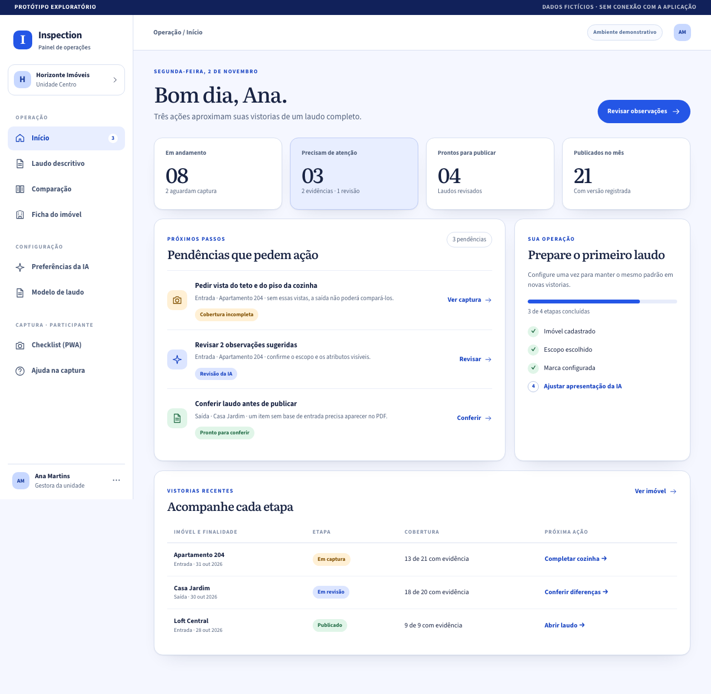

# Protótipo navegável: checklist e laudo

Este protótipo traduz as propostas do [estudo de checklist e laudo](../../estudo-checklist-laudo-flashvistoria.md) em oito telas do Inspection. Ele mostra a jornada de uma vistoria de entrada e uma comparação de saída, usando **dados fictícios** e uma **ilustração sintética** da cozinha. Não há conexão com API, upload, IA, assinatura ou emissão real de PDF.



## Abrir

Abra [o protótipo](index.html#inicio) no navegador. Para servir os arquivos localmente, na pasta deste README:

```sh
python3 -m http.server 8765
```

Depois acesse `http://127.0.0.1:8765/#inicio`. A navegação lateral permite alternar entre as telas; no celular, use o botão de menu no topo.

## Fluxo sugerido

1. **Início → Checklist:** uma pendência indica exatamente qual vista falta; a captura mostra o escopo, itens observados e lacunas separadas da condição.
2. **Checklist → Laudo:** as observações visíveis continuam presentes mesmo sem dano, com referência F01 e limites explícitos. Chaves e medidores aparecem como registros próprios.
3. **Preferências da IA → Modelo de laudo:** o gestor escolhe escopo e apresentação, vê uma prévia com dados demonstrativos e configura a identidade do documento. Checklist e comparação têm objetivos distintos.
4. **Ficha do imóvel → Comparação:** o histórico aponta a base aprovada. A comparação apresenta entrada e saída lado a lado, filtra estados e encaminha “não observado” para nova captura.
5. **Ajuda na captura:** o participante volta ao checklist após consultar uma orientação contextual.

| Tela | Ideia do estudo | Decisão representada | Capturas |
| --- | --- | --- | --- |
| Início | [§ 9.4](../../estudo-checklist-laudo-flashvistoria.md#94-início-com-próximos-passos-e-configuração-guiada--p1) | Pendências com destino claro e progresso inicial separado da cobertura do imóvel. | [Desktop](screenshots/inicio-desktop.png) · [Celular](screenshots/inicio-mobile.png) |
| Checklist | [§ 4.1–4.3](../../estudo-checklist-laudo-flashvistoria.md#4-desenho-recomendado-para-o-checklist) | Escopo explícito, evidência por componente e pedido de vista complementar. | [Desktop](screenshots/captura-desktop.png) · [Celular](screenshots/captura-mobile.png) |
| Preferências da IA | [§ 5](../../estudo-checklist-laudo-flashvistoria.md#5-dois-objetivos-de-prompt) e [§ 9.2](../../estudo-checklist-laudo-flashvistoria.md#92-preferências-da-ia-com-prévia--p1) | Escopo da análise separado de extensão, formato e linguagem do texto; prévia reage aos controles. | [Desktop](screenshots/preferencias-desktop.png) · [Celular](screenshots/preferencias-mobile.png) |
| Modelo de laudo | [§ 9.3](../../estudo-checklist-laudo-flashvistoria.md#93-marca-da-imobiliária-e-configuração-do-laudo--p1) | Marca, título, cor, estrutura e prévia antes da emissão. | [Desktop](screenshots/modelo-desktop.png) · [Celular](screenshots/modelo-mobile.png) |
| Laudo descritivo | [§ 6](../../estudo-checklist-laudo-flashvistoria.md#6-laudo-de-checklist-proposto) | Síntese, catálogo do cômodo, evidência, limitações e registros complementares na mesma leitura. | [Desktop](screenshots/laudo-desktop.png) · [Celular](screenshots/laudo-mobile.png) |
| Comparação | [§ 5.2](../../estudo-checklist-laudo-flashvistoria.md#52-comparação--mudança-histórica) e [§ 9.7](../../estudo-checklist-laudo-flashvistoria.md#97-comparação-de-entrada-e-saída-explicável--p1) | Base aprovada fixa, vistas pareadas, mudança explicada e estado “não observado” com pedido de nova foto. | [Desktop](screenshots/comparacao-desktop.png) · [Celular](screenshots/comparacao-mobile.png) |
| Ficha do imóvel | [§ 9.6](../../estudo-checklist-laudo-flashvistoria.md#96-ficha-do-imóvel-e-partes-vinculadas-à-locação--p1p2) | Imóvel, base e versões de vistoria em uma linha do tempo. | [Desktop](screenshots/imovel-desktop.png) · [Celular](screenshots/imovel-mobile.png) |
| Ajuda na captura | [§ 9.11](../../estudo-checklist-laudo-flashvistoria.md#911-ajuda-contextual-e-suporte-com-contexto-escolhido--p1p2) | Orientação curta, acessível no ponto da pendência. | [Desktop](screenshots/ajuda-desktop.png) · [Celular](screenshots/ajuda-mobile.png) |

## O que pode ser experimentado

- Navegação por menu, cartões e ações; o endereço usa hashes para permitir links diretos.
- No checklist, “Registrar nova vista” leva a cobertura da cozinha de 6/8 para 7/8 (teto) e mantém o piso sem vista. A tela mostra também quantos componentes serão comparáveis na saída.
- Nas preferências, nível de detalhe, tópicos/parágrafos e linguagem alteram a prévia. A escolha de escopo é exibida, mas não executa IA.
- No modelo de laudo, título, cor e disposição do anexo atualizam a prévia.
- Na comparação, os filtros mostram estados distintos e “Ver evidências e limites” abre detalhes.
- No laudo, a versão resumida ajusta a composição sem remover evidências ou ressalvas. “Tentar publicar” mostra o bloqueio da prévia: há componentes sem vista e observações sugeridas pela IA ainda não revisadas.
- Na comparação, o filtro “Sem base” isola o item que a entrada não fotografou; “Solicitar captura” simula o pedido de recaptura.

**Dados demonstrativos:** a entrada em captura é do **Apartamento 204** (checklist, laudo, preferências e modelo). A saída em revisão é da **Casa Jardim** (comparação e ficha do imóvel). A cozinha do Apartamento 204 tem os mesmos 8 componentes em todas as telas; geladeira e micro-ondas aparecem só como “observado fora do escopo”.

**Superfícies:** o checklist e a ajuda representam o aplicativo de captura (PWA) do participante e ficam num grupo próprio do menu. No produto, essas telas não têm o menu do painel. Ainda falta decidir se Preferências da IA e Modelo de laudo ficam no Admin, junto da política de voz, ou no Dashboard.

**Limites visuais:** a marca escura da comparação é desenhada sobre a ilustração da saída para demonstrar a interface. A imagem de entrada e saída não é prova de um dano real. F01/F03/F12, datas, pessoas, imóveis, números e condições são exemplos editoriais; uma implementação deve receber esses dados de snapshots e evidências autorizadas.

**Relação com o produto:** o estudo recomenda separar as instruções de checklist/estado atual das instruções de comparação. A tela de preferências representa parâmetros do cliente, sem oferecer edição do prompt global. O laudo deve derivar de observações persistidas e da projeção adequada ao público. Este protótipo não altera o sistema funcional.

## Verificação

As oito rotas foram renderizadas com Playwright em larguras de 1.280 px e 390 px, a partir do arquivo local. Foram conferidos ausência de rolagem horizontal, imagens carregadas e ausência de erros no console. Também foram conferidos o registro demonstrativo de vista complementar (7 de 8), os cinco filtros da comparação e o bloqueio de publicação. As 16 capturas acima foram regeneradas em 02/11/2026, após as correções da [seção 12 do estudo](../../estudo-checklist-laudo-flashvistoria.md#12-terceira-revisão-ensaio-de-prompt-e-protótipo).

Pendências conhecidas: vários textos usam de 7 a 11 px, abaixo do menor tamanho do design system (12 px), e não há modo escuro. Ambos ficam para uma iteração visual.
